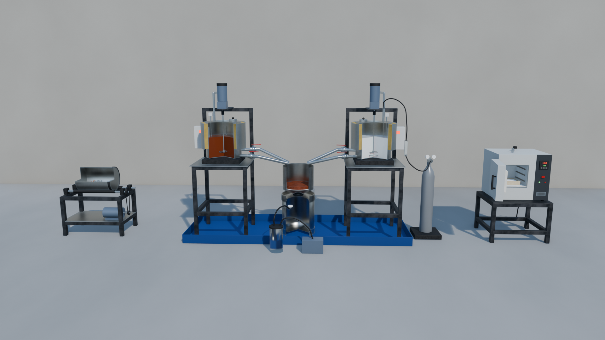

# Mini-usine bauxite → alumine

Atelier discontinu pour transformer **5 kg de bauxite** (gibbsitique, Cameroun) en **≈ 1,9 kg d'alumine**, avec quatre appareils séparés :

| Repère | Appareil | Rôle |
|---|---|---|
| A0 | Broyeur à boulets | Réduire la bauxite en poudre < 250 µm |
| R1 | Cuve agitée chauffée 50 L | Attaque à la soude, 100 °C, 2 h, pression atmosphérique |
| F | Filtre sous vide | Séparer les boues rouges, puis l'hydrate d'alumine |
| R2 | Cuve agitée chauffée 50 L + CO₂ | Précipitation de l'hydrate Al(OH)₃ par carbonatation |
| K | Four à moufle 1200 °C | Calcination à 1050 °C : Al(OH)₃ → Al₂O₃ |

## Contenu

| Fichier | Contenu |
|---|---|
| `plan-usine-bauxite-alumine.md` | Plan complet : procédé, bilan matière, pièces, mode opératoire, sécurité, achats |
| `construire_usine.py` | Script Blender qui construit la scène 3D à l'échelle 1:1 |
| `materiaux_realistes.py` | Script Blender qui applique les matériaux réels, la lumière et les caméras |
| `usine-bauxite-alumine-realiste.blend` | Modèle 3D réaliste prêt à ouvrir |
| `usine-bauxite-alumine.blend` | Première version du modèle (couleurs de schéma) |
| `animer_usine.py`, `usine-bauxite-alumine-animation.blend` | Animation du procédé (≈ 1 min 45) sur le modèle réaliste : chaque produit entre et sort par une vraie ouverture, récipients étiquetés |
| `exporter_video.cmd`, `exporter_video.py` | Export de l'animation en MP4 (Blender + ffmpeg) |
| `rendu-*.png` | Images calculées |

## Regénérer le modèle

Dans Blender 5.2, onglet **Scripting** :

- modèle fixe : ouvrir et exécuter `construire_usine.py`, puis `materiaux_realistes.py` ;
- animation : ouvrir et exécuter `animer_usine.py` (il lance lui-même les deux autres scripts, qui doivent être dans le même dossier).

## Avertissement

La soude chaude utilisée à l'étape d'attaque est très dangereuse (brûlures graves, cécité). Lire la section sécurité du plan avant toute manipulation. Les chiffres du plan sont des estimations qui n'ont pas été vérifiées par un essai réel.
